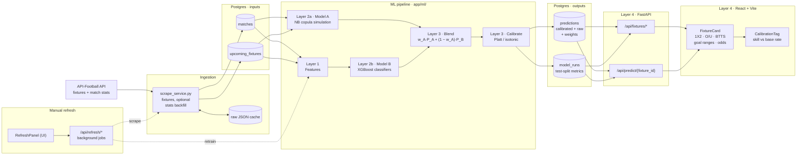
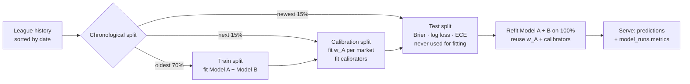

# Predict Model

Football prediction app for six domestic leagues (Premier League, La Liga,
EFL Championship, League One, League Two, Scottish Premiership) and
international football (UEFA Nations League, international friendlies,
CONCACAF Nations League, Gulf Cup of Nations, UEFA U21 Championship and its
qualifiers, Africa Cup of Nations qualifiers, plus the 2026 World Cup,
AFCON 2025 and Copa América 2024 as training history). For every
upcoming fixture it serves calibrated probabilities, and their fair
decimal odds, for:

- **Match Result / 1X2** (Home Win / Draw / Away Win)
- **Over/Under Goals** (1.5, 2.5, 3.5)
- **Both Teams To Score (BTTS)** (Yes / No)
- **Goal ranges** (1-3, 1-4, 2-3, 2-4, 2-5, 2-6, 3-5, 3-6)

Two models produce every prediction: a Negative-Binomial score simulation
(Model A) and direct XGBoost classifiers (Model B). They are blended per
market with weights fitted on held-out data, then calibrated. Each league
reports its own held-out accuracy, so you can see where the model beats
simply predicting the base rate and where it doesn't
([latest results](#latest-evaluation)).

Local, single-user app: no auth, no scheduler. You refresh data with a
button in the UI (or a `POST /api/refresh/*` call).

| Path | What's there |
|---|---|
| [`backend/app/ml/`](backend/app/ml/) | The four ML modules: features, Model A, Model B, blending and calibration |
| [`backend/app/`](backend/app/) | FastAPI service: Postgres models, routers, scrape/retrain background jobs |
| [`backend/scripts/`](backend/scripts/) | DB setup, CSV seed import, idempotent migrations |
| [`backend/tests/`](backend/tests/) | pytest suite (no database needed) |
| [`frontend/`](frontend/) | React + Vite UI |
| [`legacy/`](legacy/) | Original CLI scripts, superseded by the backend; kept for reference only |

## System Architecture Blueprint

The diagrams render on GitHub, which adds pan, zoom and full-screen
controls. If VS Code's preview shows raw code, install the *Markdown Preview
Mermaid Support* extension. The sections below each diagram expand for
details and links to the code.



Dashed arrows are the manual triggers from the UI. Trained models are also
saved to `backend/app/ml/model_store/*.joblib` and reloaded at startup
(omitted from the diagram for clarity).

<details>
<summary><b>Ingestion</b>: API-Football → Postgres</summary>

[`scrape_service.py`](backend/app/services/scrape_service.py) pulls match
history and upcoming fixtures for every competition, upserting on
`(league, date, home_team, away_team)` so re-runs never duplicate rows.
International competitions only fetch the season years that exist for them
(`LEAGUE_SEASONS`). Knockout matches decided after extra time or penalties
are stored at their 90-minute score, since every market settles on 90
minutes. The optional stats backfill (shots, shots on target, corners,
cards, xG) costs one API request per match, and the free plan allows 100 per
day. It's resumable, and every raw response is cached under
`downloaded_files/`. A season is served from cache only once all its
fixtures are settled, so every refresh re-fetches seasons still in progress
and picks up new fixtures and results.
</details>

<details>
<summary><b>International football</b>: one pooled model</summary>

Each domestic league trains its own models. The ten international
competitions share **one** model, `International`: the Gulf Cup alone has
about 30 matches in five years, and a national team's form carries across
friendlies, the Nations League and qualifiers. So Elo and rolling stats are
built over all of a team's international matches, whatever the competition.
Fixtures keep their competition name for filtering, and `/api/leagues`
reports each competition's `model_group`. U21 Championship qualifiers are
included so U21 sides have more history than the finals, which are played
every two years. The 2026 World Cup, AFCON 2025 and Copa América 2024
have no upcoming fixtures, but they're the most recent competitive matches
for most national teams, so they're included as history. The model uses the goals-only tier, because international
matches have no xG coverage.

Known limitations: the model has no neutral-venue flag, so tournament
matches at a host nation still treat the listed home side as at home. API-Football
also lists a few pre-tournament warm-ups against club sides under
friendlies.
</details>

<details>
<summary><b>Layer 1: Features</b> (<code>features.py</code>)</summary>

[`features.py`](backend/app/ml/features.py) builds Model B's inputs for
each side:

- rolling 5- and 10-match goals, xG, shots and shots on target, for and against
- shot conversion over the last 10 matches
- xG-adjusted Elo: the match signal blends the actual goal margin with the
  xG margin when xG exists
- rest days, capped at 30
- head-to-head record from the last 6 meetings (goal difference from the
  home side's view, average total goals, BTTS rate)

Training and prediction share **one code path**. Each target row looks up
each team's state as of its last completed match *strictly before* the
target date (`pd.merge_asof(allow_exact_matches=False)`). A fixture can't
see its own or later results, and an upcoming fixture gets exactly the
features a historical match on that date would have had. Tests enforce both
properties.
</details>

<details>
<summary><b>Layer 2a: Model A</b>, the Negative-Binomial copula simulation</summary>

[`football_goal_range_model.py`](backend/app/ml/football_goal_range_model.py)
works in three steps:

1. Two Poisson-objective XGBoost regressors predict expected goals
   (`lambda_home`, `lambda_away`).
2. A Negative-Binomial dispersion fitted from residuals accounts for
   football's over-dispersion.
3. 20,000 correlated home/away score draws are simulated via a Gaussian
   copula (ρ = −0.1, a Dixon-Coles-style low-score adjustment).

Every market is an aggregation over that one sample set:

| Market | Derivation |
|---|---|
| Goal range (e.g. "2-4") | `P(lo <= home+away <= hi)` |
| 1X2 | `P(home>away)` / `P(home==away)` / `P(home<away)` |
| Over *N* | `P(home+away > N)` |
| BTTS | `P(home>0 AND away>0)` |

Model A uses its own feature set (rolling goals, shots and xG, plus Elo).
Leagues with rich data (Premier League, La Liga, Championship) use a
10-match window; the others use 6.
</details>

<details>
<summary><b>Layer 2b: Model B</b>, direct GBDT classifiers</summary>

[`gbdt_models.py`](backend/app/ml/gbdt_models.py) trains XGBoost
classifiers directly on outcomes:
- `multi:softprob` for 1X2
- `binary:logistic` for BTTS and each Over line

The trees are deliberately low-capacity (depth 3, learning rate 0.03,
`min_child_weight` 5), because each league has only 1–2k matches. There are
no goal-range classifiers, so goal ranges stay Model A only.
</details>

<details>
<summary><b>Layer 3: Blend, calibrate, evaluate</b> (<code>calibration.py</code>, <code>ensemble.py</code>)</summary>

For each market, [`ensemble.py`](backend/app/ml/ensemble.py) runs:

1. **Blend:** `P = w_A·P_A + (1 − w_A)·P_B`, with `w_A` chosen by grid search
   (steps of 0.05) to minimise log loss on the calibration split. The spec
   defaults (0.45 for 1X2/BTTS/O-U, 0.80 for goal ranges) apply when that
   split has fewer than 50 matches.
2. **Calibrate:** Platt scaling (a logistic regression on the logit, the
   same mapping as `CalibratedClassifierCV(method="sigmoid")`) for the
   binary markets; isotonic is implemented too. 1X2 uses single-parameter
   multinomial temperature scaling, `softmax(log P / T)`, kept only if it
   lowers log loss out-of-fold (5 contiguous folds of the calibration
   split) compared with the raw blend; otherwise the raw 1X2 blend passes
   through unchanged. `model_runs.metrics.markets.*.calibrator` records
   which one each market got. The same gate was tried on the binary
   markets and dropped, because on held-out data it discarded Platt where
   Platt helped.
3. **Evaluate:** Brier score, log loss and ECE for Model A, Model B, the
   raw blend, the calibrated blend, and a base-rate baseline.

**Market consistency.** Each market is blended and calibrated on its own,
so the final P(Over 2.5) need not exactly match the goal-range numbers.
That's the trade-off accepted for per-market calibration.
</details>

<details>
<summary><b>Layer 4: API and UI</b></summary>

The `predictions` table's market columns hold the final calibrated numbers.
`raw_probabilities` keeps the Model A, Model B and blended values, and
`ensemble_weights` the per-market `w_A`. Each league's test-split metrics
live in `model_runs.metrics`.

| Endpoint | Returns |
|---|---|
| `GET /api/fixtures/upcoming` | Upcoming fixtures (`status=NS`) with their current predictions; filter by `league`, `start`, `end` |
| `GET /api/predict/{fixture_id}` | One fixture's calibrated prediction, raw probabilities, blend weights and its league's Brier scores |
| `GET /api/fixtures/{fixture_id}?full_distribution=true` | Adds a live 0..8+ total-goals distribution from Model A |
| `GET /api/leagues` | Leagues with last-trained time |
| `POST /api/refresh/{full,scrape,retrain}` | Background jobs, one at a time; poll `GET /api/refresh/status/{job_id}` |

Decimal odds (`*_odds`, fair odds of `1/p` with no bookmaker margin) are
computed at response time from the stored probabilities, not persisted.
Each card's **CalibrationTag** shows the league's Brier skill (see
below). Hover it for the full breakdown and blend weights. Predictions made
before the ensemble shipped show "Uncalibrated · Model A only" until their
league is retrained.
</details>

### Training pipeline, per league



The weights and calibrators are fitted on a different split from the one
the metrics are reported on, so the displayed scores aren't graded on data
the model was tuned against. The final refit uses all history, because the
most recent matches matter most in football. The trade-off is that the
calibrators were fitted against slightly weaker models than the ones
served.

## Quickstart

Prerequisites: a native Postgres install running on your machine (port
5432) -- **not** something Docker Compose provisions for you. Earlier
versions ran Postgres as a Docker container with a named volume, but that
volume was found to not survive a Docker Desktop restart/reset (its
internal WSL2 storage got wiped); a native install is completely outside
Docker's lifecycle, so it doesn't have that failure mode.

One-time setup, in `psql` or any Postgres client:

```sql
CREATE ROLE predict WITH LOGIN PASSWORD 'predict';
CREATE DATABASE predict_model OWNER predict;
```

Two ways to run the app itself:

- **Docker Compose** -- backend, frontend and the evaluation dashboard
  containerized; Postgres stays native. Fewer moving parts, but a rebuild
  is needed after most backend/dependency changes.
- **Native** -- backend and frontend also run directly on your machine
  (`--reload`/Vite HMR). Needs Python 3.10+ and Node 18+.

### Docker Compose (backend/frontend/dashboard)

```powershell
copy backend\.env.example backend\.env   # then set API_FOOTBALL_KEY in it
docker compose up -d --build
```

One-off DB setup, run once against the freshly created database (safe to
re-run):

```powershell
docker compose exec backend python scripts/init_db.py
docker compose exec backend python scripts/import_csv_to_postgres.py
docker compose exec backend python scripts/migrate_add_markets.py
docker compose exec backend python scripts/migrate_add_ensemble.py
docker compose exec backend python scripts/migrate_add_value.py
docker compose exec backend python scripts/import_historical_odds.py
```

Then open http://localhost:5173 (frontend), http://localhost:8000/docs
(backend API), and http://localhost:8501 (evaluation dashboard, see
`app.py`). The `backend` and `dashboard` services reach your native
Postgres via `host.docker.internal:5432`, Docker Desktop's DNS name for
the host machine.

### Native

Prerequisites: Python 3.10+, Node 18+, the native Postgres role/database
from above already created.

Follow **Backend setup** and **Frontend setup** in separate terminals
(both need to stay running), and open http://localhost:5173.

### Backend setup

```powershell
cd backend
python -m venv venv
venv\Scripts\Activate.ps1              # bash/WSL: source venv/Scripts/activate
pip install -r requirements.txt

copy .env.example .env                 # then set API_FOOTBALL_KEY in it
#   DATABASE_URL already points at localhost:5432 (the native Postgres above)

python scripts\init_db.py              # creates tables (safe to re-run)
python scripts\import_csv_to_postgres.py   # one-off: seeds Postgres from the root CSVs
python scripts\migrate_add_markets.py  # adds the 1X2/O-U/BTTS columns (safe to re-run)
python scripts\migrate_add_ensemble.py # adds ensemble/calibration columns (safe to re-run)
python scripts\migrate_add_value.py    # adds bookmaker odds / value-bet columns (safe to re-run)
python scripts\import_historical_odds.py  # Bet365 odds 2022/23+ into match_odds (model inputs; safe to re-run)

uvicorn app.main:app --reload --port 8000
```

Check it's running: http://localhost:8000/api/health should return
`{"status": "ok"}`, and http://localhost:8000/docs has the interactive
(Swagger) API reference.

### Frontend setup

```powershell
cd frontend
npm install
npm run dev
```

`vite.config.ts` proxies `/api` to `localhost:8000`, so local development
needs no CORS setup or `.env`.

### First run

The seed import gives you a populated fixtures list straight away, but those
predictions are Model A only and uncalibrated. Click **Refresh data** in the
UI (or `POST /api/refresh/retrain`) to train the full ensemble. That takes
about 3 minutes per league (about 6 minutes for the ~4k-match International
model), about 25 minutes for everything.

## Backup & recovery

Postgres is a native host install (see Quickstart above) -- outside
Docker's lifecycle, but also outside any container-level backup tooling.
Nothing backs it up automatically; triggering it (from the UI or the CLI)
is on you.

**From the app** -- the **Advanced** section of the refresh panel has a
**Backup database** button, next to Scrape/Retrain. It runs the same
`pg_dump` logic as the CLI script below (`app/services/backup_service.py`,
shared by both), streams progress in the same log console, and writes to
`backend/backups/` (gitignored) -- mounted as a volume in
`docker-compose.yml` so a dump taken through Docker Compose lands on the
host, not inside the container's disposable filesystem.

**From the CLI** -- same dump, custom `pg_dump` format (compressed,
supports restoring a single table), for scripting or scheduling:

```powershell
cd backend
python scripts\backup_db.py            # keeps the 14 most recent dumps by default
python scripts\backup_db.py --keep 30  # or a different retention count
```

**Restore** -- from the newest backup, or a specific file. `--clean` drops
existing tables first, so this is destructive; it requires `--yes`. CLI
only -- there's no restore button in the UI:

```powershell
python scripts\restore_db.py --yes                       # newest backup in backend/backups/
python scripts\restore_db.py backend\backups\predict_model_20260928_184948.dump --yes
```

**Scheduling** (optional) -- nothing runs a backup on a timer by default;
it's a manual button/command. If you want it automatic later, a Windows
Task Scheduler entry pointed at `backup_db.py` works:

```powershell
schtasks /create /tn "predict-model-backup" /sc daily /st 03:00 ^
  /tr "C:\path\to\venv\Scripts\python.exe C:\path\to\backend\scripts\backup_db.py"
```

Both the button and the CLI scripts read `DATABASE_URL` from
`backend/.env` (via `app.config`), so they work the same whether Postgres
is local or on another host.

## Sharing to Telegram

The **Share to Telegram** button (next to the date-range filter) publishes
every fixture/prediction currently in view -- whatever league/date range is
selected -- as a text digest to a Telegram chat or channel, via a bot. The
app runs on localhost, so a share *link* wouldn't be openable by anyone
else; the bot pushes the content out instead.

One-time setup:

1. Message [@BotFather](https://t.me/BotFather) in Telegram, `/newbot`,
   follow the prompts -- you get a bot token back.
2. Get the numeric chat/channel ID: message your new bot directly, then
   visit `https://api.telegram.org/bot<token>/getUpdates` in a browser and
   read `"chat":{"id": ...}` from the JSON. For a channel, add the bot as
   an admin instead and use the channel's ID (starts with `-100`).
3. Set both in `backend/.env`:
   ```
   TELEGRAM_BOT_TOKEN=your-bot-token-here
   TELEGRAM_CHAT_ID=your-chat-id-here
   ```
   Rebuild/restart the backend for the new values to take effect.

Without these set, the button returns a clear "not configured" error
instead of failing silently.

## Latest evaluation

Brier skill score on each league's test split, from the retrain on
2026-09-23: `1 − Brier(calibrated) / Brier(always predicting the league's
base rate)`. Positive means the model beat the base rate on matches it
never saw during fitting. `w` is Model A's share of the blend.

| League | Test matches | 1X2 | BTTS | Over 1.5 | Over 2.5 | Over 3.5 |
|---|---|---|---|---|---|---|
| EFL Championship | 354 | +0.5% (w 0.85) | +2.7% (w 0.25) | +1.6% (w 0.15) | +1.7% (w 0.10) | +0.0% (w 0.55) |
| La Liga | 292 | +3.8% (w 0.45) | +0.1% (w 0.55) | +0.7% (w 0.50) | +2.3% (w 0.60) | +1.0% (w 0.50) |
| League One | 349 | +4.1% (w 0.70) | +1.1% (w 0.65) | +0.9% (w 0.85) | +0.3% (w 0.75) | +1.5% (w 1.00) |
| League Two | 349 | +0.6% (w 0.85) | −0.1% (w 0.65) | +0.3% (w 0.80) | −0.9% (w 0.70) | +0.2% (w 0.30) |
| Premier League | 298 | +2.3% (w 0.85) | +0.3% (w 0.50) | −0.2% (w 0.35) | +1.8% (w 0.85) | +1.9% (w 0.50) |
| Scottish Premiership | 147 | +8.0% (w 0.65) | +0.0% (w 0.70) | +0.0% (w 0.60) | −0.8% (w 0.70) | +0.8% (w 0.75) |
| International (all 10 competitions) | 638 | +9.0% (w 0.55) | +1.4% (w 0.30) | +0.7% (w 0.15) | +0.9% (w 0.20) | +0.8% (w 0.25) |

How to read it:

- **1X2 is where the model adds value.** It beats the base rate in every
  league.
- **Goal markets are close to unpredictable** from pre-match data, landing
  between −1% and +2%. That's normal for football, not a bug.
- **Small samples make the extremes noisy.** Scottish Premiership's +8% comes
  from only 147 test matches, and some fitted weights swing to the extremes
  (Championship Over 2.5 gives Model A only 0.10). See
  [Recommended next steps](#recommended-next-steps-more-stable-numbers).
- **Calibration helps the binary markets but hurts 1X2.** Comparing test
  Brier before and after calibration: Over/Under improves in all 6 leagues
  and BTTS in 5 of 6, but 1X2 gets worse in 4 of 6 (League One 0.619 →
  0.631, La Liga, League Two, Scottish Premiership). The blend alone was
  already well calibrated for 1X2. Fixed since this table was produced:
  1X2 now uses gated temperature scaling (see Layer 3). On the seed
  `matches.csv` it beat one-vs-rest Platt on test Brier in 6 of 6 leagues
  (e.g. League One skill +4.3% → +5.9%, Premier League +2.0% → +2.9%).
  Retrain to refresh this table.

These numbers change with every retrain. To get the current ones, call
`GET /api/predict/{fixture_id}` (`brier_scores`), or run
`SELECT league, metrics->'markets' FROM model_runs;`.

## Value bets and backtesting

`backend/app/ml/value_engine.py` sits on top of the calibrated probabilities:

- **Market probabilities:** bookmaker odds are de-margined with Shin's
  method, which takes more margin off longshots than favourites (the
  favourite-longshot bias). Returned as `market_probabilities`.
- **Expected value:** `EV = p_model × odds − 1`, against the price actually
  offered, not the fair price, because the margin is a real cost of the bet.
- **Market shrinkage:** where a fixture has odds, the calibrated
  probabilities are pulled toward the de-vigged market:
  `p = (1 − w)·p_model + w·p_market`, with a fixed w = 0.70. Each retrain
  also fits w per league for 1X2 and O/U 2.5 and records it in
  `model_runs.metrics` (`vs_market.w_market_fitted`). Those fits aren't
  served: on the 2025/26 backtest they did no better than 0.70 and swung
  between 0.00 and 1.00. `USE_FITTED_SHRINKAGE` in `calibration.py` switches
  them on. Fixtures without odds keep the model's probabilities.
- **Market features:** Model B also takes the de-vigged opening prices
  (`opening_prob_home/draw/away/over_2.5`) as inputs. Historical prices are
  Bet365 from football-data.co.uk, stored in `match_odds`. For upcoming
  fixtures it's the API-Football snapshot, so an odds refresh re-runs the
  league's predictions.
- **Value flag (guardrails):** `is_value_bet` when an outcome has EV ≥ 2.5%
  *and* its probability edge over the de-vigged market is ≤ 7 points
  (`MAX_EDGE_CAP`). Bigger gaps are overwhelmingly model error, not value.
  `value_selection` is the highest-EV outcome that passes. `recommended_stake`
  is its quarter-Kelly stake in units (1 unit = 1% of bankroll, capped at
  5 units).

Odds come from API-Football's `/odds` (Bet365 preferred to match the
training data, then Pinnacle) and are stored on the prediction row
(`bookmaker_odds`, `odds_fetched_at`). They are the latest pre-match
snapshot, and only "closing" if the last refresh ran just before kickoff.
The UI shows a green **+EV** badge with the stake on value fixtures.

**Backtest** (`backend/scripts/run_backtest.py`): walk-forward out-of-sample
predictions for a past season, against football-data.co.uk historical odds
(API-Football drops odds about a week after a match):

```powershell
python scripts\run_backtest.py                      # 2025/26, shrinkage w=0.70, bet Bet365's opening price
python scripts\run_backtest.py --shrinkage fitted   # per-league fitted weights (or: none, 0.5, ...)
python scripts\run_backtest.py --price closing      # bet the closing price instead
python scripts\run_backtest.py --refit-months 1     # retrain monthly instead of freezing at 1 July (slow)
python scripts\run_backtest.py --staking flat --min-ev 0.05 --out bets.csv
```

Shrinkage and betting both use Bet365's *opening* price, the one that
exists when a bet would be placed. The closing-market Brier is reported as
the stricter benchmark. The report ends with a comparison of no shrinkage,
w = 0.70 and fitted w, for EPL + La Liga and for all six leagues.

The first run trains each domestic league on matches before 1 July of the
season start (about 3 minutes per league) and caches the predictions under
`downloaded_files/backtest/`. Later runs with different thresholds or staking
are instant. It covers 1X2 and O/U 2.5 only: football-data has no BTTS odds,
and there's no odds source for the international competitions. The report
gives ROI, win rate, drawdown, a match-clustered bootstrap p-value and CI for
ROI > 0, and model-vs-market Brier / log loss. That last comparison matters
most: a model that can't beat the de-margined closing line on Brier has no
durable edge, whatever one season's ROI says.

## Tests

```powershell
cd backend
pip install -r requirements-dev.txt
python -m pytest
```

45 tests, no database needed. They cover:
- **Leakage:** rewriting later results can't change earlier features.
- **Train/serve parity:** features built for an upcoming fixture match the
  training features for the same match.
- **Feature correctness:** rest days, head-to-head from the home side's view,
  Elo direction.
- **Metrics:** log loss, Brier score and ECE checked against scikit-learn.
- **Calibration and blending:** calibrators fix miscalibration out of sample,
  temperature scaling undoes overconfident 1X2 probabilities, the
  out-of-fold gate falls back to identity when a calibrator doesn't help,
  and blend weights favour the informative model.
- **End to end:** ensemble training on synthetic data.
- **Competitions:** every scraped competition maps to a trained model group,
  knockout results use the 90-minute score, and in-progress seasons are
  re-fetched.
- **Value layer:** Shin de-margining (sums to 1, shades longshots), EV and
  capped fractional Kelly, API-Football odds parsing, and the backtest engine
  finding a planted edge (significant) but not noise (not significant).
- **Market shrinkage and guardrails:** the shrinkage formula and missing-odds
  passthrough, the fitted weight leaning toward whichever source is less
  noisy, market features passing through the feature frame, shrinkage
  applied at serving time, and the edge cap and 2.5% EV threshold.

## Manual refresh

| Action | Endpoint |
|---|---|
| Scrape fixtures + retrain (the UI's main button) | `POST /api/refresh/full` |
| Scrape fixtures only | `POST /api/refresh/scrape` `{"include_stats": false}` |
| Scrape + backfill shots/corners/cards/xG | `POST /api/refresh/scrape` `{"include_stats": true}` |
| Retrain only (uses whatever's already in Postgres) | `POST /api/refresh/retrain` `{"leagues": [...]}` (omit for all) |
| Skip the bookmaker-odds fetch (on by default for scrape and full) | add `"include_odds": false` |

The odds fetch costs one request per predicted fixture kicking off in the
next 3 days (`ODDS_DAYS_AHEAD`), nearest first, and stops at the daily
budget guard.

Jobs run one at a time in the background. Run the stats backfill on its own
and repeat it daily until nothing is left to fetch, because of the 100
requests/day free-plan limit.

## Derived markets and the betslip: limits to improve

Beyond 1X2, BTTS, Over/Under and the goal ranges, each card has a "More
markets" row group: double chance, team totals (0.5/1.5/2.5), 1X2 and O/U
combined with BTTS, and odd/even total goals. Picks from any market go on the
Betslip tab (accumulator only, kept in the browser's `localStorage`).

Double chance is summed from the calibrated 1X2. The others come from the same
simulated scoreline as Model A and get their own Platt calibrator per event
(`extra_flat_masks` in
[`football_goal_range_model.py`](backend/app/ml/football_goal_range_model.py),
calibrated in `train_ensemble`). They only appear after a league has been
retrained, and three things about them are weaker than the core markets:

1. **No bookmaker odds, so no value bets and no market shrinkage.** The odds
   scraper only reads Match Winner, Goals Over/Under and Both Teams Score
   (`ODDS_MARKETS` in
   [`scrape_service.py`](backend/app/services/scrape_service.py)). On the
   betslip these markets therefore show the model's fair odds (greyed, with a
   warning), and they're excluded from value-bet detection. **Planned fix:**
   once there's an Odds API subscription, add these markets to the odds
   ingestion (double chance, team totals, result/BTTS and total/BTTS combos,
   odd/even) and map them onto the same flat keys. The betslip already
   prefers `bookmaker_odds` over fair odds, so it picks them up as soon as
   they're stored. Shrinkage weights for these markets will use the default
   until there's enough odds history to fit them.
2. **Model A only, no second model.** Unlike 1X2, BTTS and O/U, there's no
   Model B blended in, so these markets are less accurate even after
   calibration. Options, cheapest first: rescale the BTTS combos and team
   totals to agree with the calibrated 1X2, BTTS and O/U; then, if that isn't
   enough, add GBDT classifiers for the most-used ones.
3. **Skill on real data isn't checked yet.** The calibrators were only
   exercised on synthetic data. After a real retrain, compare each market's
   calibrated Brier score with the base rate in the league's metrics. If a
   market doesn't beat it, hide it for that league rather than show it.

Fixing 1 doesn't fix 2 or 3.

## Recommended next steps: more stable numbers

Each league trains on only 1–2k matches, so the calibration split has
roughly 150–350 matches, and the test split about the same. That is enough
to fit the models, but it leaves the blend weights, calibrators and
reported skill noticeably noisy. In rough order of expected impact:

1. ~~**Fix 1X2 calibration.**~~ Done: gated temperature scaling
   (`TemperatureCalibrator` and `fit_calibrator_or_identity` in
   [`calibration.py`](backend/app/ml/calibration.py)).
2. **Pool training across leagues.** Train one Model B, and fit one set of
   calibrators, on all six leagues (about 11.8k matches), with league and
   tier as categorical features. That's about 6× the data behind every
   fitted parameter, and the classifiers can still learn league-specific
   effects. Keep Model A per league, since its goal rates are genuinely
   league-specific. *Where:* `train_ensemble` in
   [`ensemble.py`](backend/app/ml/ensemble.py) becomes a cross-league
   function, and `retrain_leagues` in
   [`model_service.py`](backend/app/services/model_service.py) calls it once
   instead of once per league.
3. **Shrink per-league blend weights toward a pooled weight.** Use
   `w_league = (n·ŵ_league + k·ŵ_pooled) / (n + k)` with `k ≈ 300`, so a
   league with little data (Scottish Premiership) leans on the pooled
   estimate instead of swinging to 0.10 or 1.00 on ~350 matches. *Where:*
   `fit_blend_weight` in [`calibration.py`](backend/app/ml/calibration.py).
4. **Show uncertainty on the skill numbers.** Bootstrap the test matches
   (about 1,000 resamples) and store an interval next to each Brier skill,
   so the tag reads e.g. "+8.0% ± 5%". Then a small-sample league looks
   uncertain rather than impressive. *Where:* `evaluate` in `calibration.py`,
   `CalibrationTag.tsx`.
5. **Walk-forward evaluation instead of one split.** Evaluate on several
   consecutive windows (e.g. 4 × 10%), report the mean and spread, and fit
   calibrators on the pooled out-of-fold predictions. That gives more
   calibration data and an honest picture of how skill varies over time.
6. **Finish the xG backfill for the lower leagues.** League One, League Two
   and Scottish Premiership have only 15–20% xG coverage, versus 70–75% for
   the top three. The stats backfill fills it in 100 matches a day.

**How to tell it worked:** run the walk-forward evaluation (step 5) before
and after each change. It should show a smaller spread in the skill
numbers, and more stable blend weights between retrains. Also watch that
mean Brier skill doesn't drop.

## Notes

- Running
  [`football_goal_range_model.py`](backend/app/ml/football_goal_range_model.py)
  directly (`python -m app.ml.football_goal_range_model` from `backend/`)
  trains Model A on the root `matches.csv` seed data and prints a holdout
  calibration check per league. Useful for experimenting without the API or
  database running.
- There's no Alembic. Adding a column to an existing table needs a small
  idempotent script (`backend/scripts/migrate_add_*.py` shows the pattern).
  `init_db.py`'s `create_all()` only creates missing tables, never new
  columns on existing ones.
- Model files live in `backend/app/ml/model_store/` (gitignored). Model A is
  saved as `{league}.joblib`, and the ensemble (Model B, weights,
  calibrators, metrics) as `{league}_ensemble.joblib`. Both reload at
  startup, so a restart never forces a retrain.
